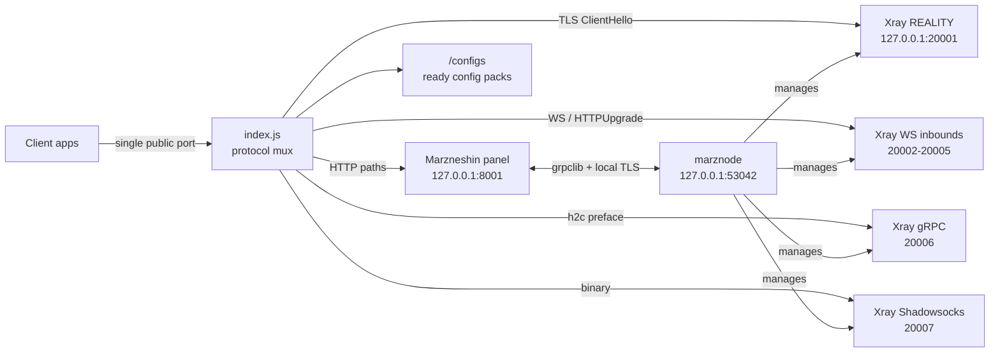

<div align="center">


<br><br>

[](LICENSE)
[](package.json)
[](package.json)
[](#-quick-start)
[](https://katabump.com)
[](https://github.com/XTLS/Xray-core)
[](https://github.com/Batman-panel/marzneshin-katabump/stargazers)

### **Two files. One public port. Every protocol. Every operator.**

**A production-style Marzneshin panel that actually boots on KataBump's free tier
— and hands you a ready-to-import config pack the moment it starts.**

**🌐 Languages:** [English](#-english) · [فارسی](#-فارسی) · [العربية](#-العربية) · [Русский](#-русский) · [中文](#-中文) · [Türkçe](#-türkçe)

[🚀 Quick start](#-quick-start) · [📡 Ready configs](#-ready-made-configs) · [⚙️ Env vars](#-environment-variables) · [🩺 Troubleshooting](#-troubleshooting) · [⭐ Star this repo](https://github.com/Batman-panel/marzneshin-katabump)

</div>

---

<a id="-english"></a>

## 🇬🇧 English

### ✨ What is this?

A **two-file, zero-dependency deployment** of [Marzneshin](https://github.com/marzneshin/marzneshin) — panel, `marznode`, and Xray-core — designed for the **single public port** that [KataBump](https://katabump.com) gives every free server (308 MB RAM, 716 MB disk, 25% CPU, no root).

Upload `index.js` + `package.json`, run `npm start`, and walk away. On first boot the wrapper downloads and wires everything: portable CPython, the pinned panel source, the prebuilt dashboard (embedded in `index.js`), `marznode`, Xray-core, TLS certificates, SQLite migrations, an admin account, a node, **seven inbounds**, a service, a demo user — and then **generates a complete config pack for all seven protocols in five per-operator profiles.**

> **The reason this edition exists:** the upstream-style wrapper died on KataBump with
> `/home/container/marzneshin/venv/bin/python: No module named pip` and then hung forever.
> KataBump ships a Debian Python with `ensurepip` stripped out. This build bootstraps pip
> from a standalone `pip.pyz` zipapp and never depends on `ensurepip` again.

### 🎯 Highlights

| | |
|---|---|
| 📦 **2-file deployment** — no `npm install`, no build step, no Docker | 🔌 **1 public port** — panel, API, dashboard, subscriptions and seven proxy transports multiplexed on one TCP port |
| 🐍 **Bulletproof Python** — `venv --without-pip` → `ensurepip` → `get-pip.py` → `pip.pyz` → portable CPython fallback | 📡 **Ready configs** — `/configs` page + `CONFIGS.txt` + `configs/*.txt`, `*.sub`, `*.url` files, generated automatically |
| 🧩 **7 transports** — Reality, VLESS-WS, VMess-WS, Trojan-WS, HTTPUpgrade, gRPC, Shadowsocks | 👥 **5 operator profiles** — All / MCI / Irancell / Rightel / Fixed-line, each with its own Reality SNI |
| 🧠 **308 MB friendly** — 48–64 MB Node heap, Go GC limits, lazy Python imports, memory watchdog | 🩺 **Observable** — live heartbeat during `pip install`, `/_kb/status` JSON, `ERROR.txt`, auto-retry boot (3×) |
| 🔐 **Optional access control** — `MZ_CONFIGS_TOKEN` protects the config page | 🔧 **Fully tunable** — every path, port, SNI, version and credential is an env var |

### 🆚 Comparison

| Feature | Stock Marzneshin | PasarGuard · KataBump | **This edition** |
|---|:---:|:---:|:---:|
| Two-file / zero-dependency deploy | ❌ | ✅ | ✅ |
| Boots on KataBump's `ensurepip`-less Python | ❌ | ⚠️ needs portable Python | ✅ pip.pyz bootstrap |
| Config available immediately after boot | ❌ manual | ⚠️ one VLESS-WS inbound | ✅ 7 protocols × 5 profiles |
| Per-operator SNI profiles | ❌ | ❌ | ✅ |
| Clash / Sing-box / Xray / v2ray formats | ✅ | ✅ | ✅ |
| Auto-retry + `ERROR.txt` on boot failure | ❌ | ❌ | ✅ |
| Shadowsocks catch-all on the same port | ❌ | ❌ | ✅ |

### 🚀 Quick start

1. Create a **Node.js** server on [KataBump](https://katabump.com) (the free 4-day credit is enough).
2. Upload `index.js` and `package.json` into the server root (`/home/container/`).
3. Set the startup command to:

   ```bash
   npm start
   ```

4. Start the server. First boot takes **2–5 minutes** while Python, the panel and Xray are installed. You will see progress — it never goes silent:

   ```text
     Marzneshin  ·  KataBump Edition
     panel + marznode + xray on a single public port 20334
     + public port 20334 open
     + public host: 51.75.118.17
     + python 3.11.2  (python3.11)

   ==> preparing python environment (2-5 min on the first start)
     ! this python has no ensurepip - bootstrapping pip from the internet
     + pip bootstrapped from pip.pyz
   [marzneshin] installing 32 python packages ...
   [marzneshin] pip install (working) 20s elapsed
     + python packages installed
     + xray ready Xray 25.3.6
     + database ready
     + admin account created: admin
     + hosts pointed at 51.75.118.17:20334 (7)
     + ready configs: 7 protocols x 5 operator profiles -> marzneshin/CONFIGS.txt

   ============================================================
      Panel   : http://51.75.118.17:20334/dashboard/
      Configs : http://51.75.118.17:20334/configs
      Username: admin
      Password: ************
   ============================================================
   [marzneshin] boot finished in 34s
   ```

5. Open **`http://YOUR-SERVER-IP:PORT/configs`** — copy any subscription link into v2rayNG, v2rayN, NekoBox, Hiddify, Shadowrocket, Clash Meta or Sing-box.

> Upgrading from a broken install? Set `MZ_FORCE_SETUP=1` for one start, then remove it.
> Your database (`marzneshin/data`) is never touched.

### 🔑 Login

| Field | Value |
|---|---|
| Username | `admin` (`ADMIN_USER`) |
| Password | random, or `ADMIN_PASS` |
| Saved in | `marzneshin/PANEL.txt` + printed in the console |

### 📡 Ready-made configs

**Every inbound shares the single public port.** A tiny protocol-aware mux inspects the first bytes of each connection and forwards it to the right Xray inbound:

| # | Protocol | Trigger | Path / setting |
|---|---|---|---|
| 1 | **VLESS + REALITY** (Vision) | TLS ClientHello (`0x16 0x03`) | SNI `www.speedtest.net` (configurable) |
| 2 | **VLESS + WebSocket** | HTTP request | `/vless` |
| 3 | **VMess + WebSocket** | HTTP request | `/vmess` |
| 4 | **Trojan + WebSocket** | HTTP request | `/trojan` |
| 5 | **VLESS + HTTPUpgrade** | HTTP request | `/upgrade` |
| 6 | **VLESS + gRPC** | h2c `PRI *` preface | serviceName `vless-grpc` |
| 7 | **Shadowsocks** | any other binary stream | `chacha20-ietf-poly1305` |

**Operator profiles** — identical protocol sets, different Reality SNI (all SNIs are added to Xray's `serverNames`, so they really work). If one SNI is filtered on a carrier, try another:

| Profile | Subscription | SNI |
|---|---|---|
| All operators | `/configs/all` | `www.speedtest.net` |
| MCI (همراه اول) | `/configs/mci` | `www.speedtest.net` |
| Irancell | `/configs/irancell` | `www.microsoft.com` |
| Rightel | `/configs/rightel` | `www.cloudflare.com` |
| Fixed-line / Shatel | `/configs/shatel` | `cdn.jsdelivr.net` |

**Formats** (proxied from the panel's native v2share subscription): `/configs/v2ray` (Base64), `/configs/links`, `/configs/clash`, `/configs/clash-meta`, `/configs/sing-box`, `/configs/xray`.

**Files written to disk:**

```text
marzneshin/CONFIGS.txt            all links, all profiles, all formats, in one file
marzneshin/PANEL.txt              panel URL + admin credentials
marzneshin/configs/all.txt        7 raw share links
marzneshin/configs/all.sub        same links, Base64 subscription
marzneshin/configs/mci.txt ...    the same files per operator
marzneshin/configs/*.url          ready-to-copy subscription URLs
```

> The config page belongs to the `demo` user. Create real users in the panel for production,
> and set `MZ_CONFIGS_TOKEN` so `/configs` is not public.

### 🔗 Endpoints

| Path | Purpose |
|---|---|
| `/configs` | Ready-configs page (Persian RTL, no external assets, copy buttons) |
| `/configs/<profile>` | Base64 subscription for one operator profile |
| `/configs/<profile>.txt` | Plain share links |
| `/configs/refresh` · `/configs/json` | Force refresh · JSON output |
| `/configs/<format>` | `v2ray` / `links` / `clash` / `clash-meta` / `sing-box` / `xray` |
| `/dashboard/` | Web panel |
| `/sub/...` | Native Marzneshin subscription |
| `/docs` · `/redoc` | API documentation |
| `/_kb/status` | Live JSON status |

### 🏗️ Architecture



<details><summary>ASCII fallback</summary>

```text
                  ┌──────────────────── KataBump server ─────────────────────┐
 Internet ──────▶ │  index.js  (ONE public port)                             │
                  │    ├── /dashboard /api /sub ──▶ Marzneshin panel :8001   │
                  │    ├── /configs ..............▶ built-in config packs     │
                  │    ├── TLS ...................▶ Xray REALITY :20001       │
                  │    ├── /vless /vmess /trojan .▶ Xray WS     :20002-4     │
                  │    ├── /upgrade ..............▶ HTTPUpgrade :20005       │
                  │    ├── PRI * .................▶ Xray gRPC    :20006      │
                  │    └── binary ................▶ Shadowsocks  :20007      │
                  │                     ▲                                    │
                  │      marznode :53042 ┘  (grpclib + local self-signed TLS) │
                  └─────────────────────────────────────────────────────────┘
```

</details>

### ⚙️ Environment variables

<details><summary><b>Panel &amp; access</b></summary>

| Variable | Default | Description |
|---|---|---|
| `ADMIN_USER` | `admin` | Admin username |
| `ADMIN_PASS` | random | Admin password |
| `MZ_PUBLIC_HOST` | auto-detected | Public IP/domain used inside links |
| `MZ_DEMO_USER` | `demo` | Owner of the ready config pack |
| `MZ_CONFIGS_TOKEN` | empty | Require `?key=...` on `/configs` |
| `SERVER_PORT` / `PORT` | `3000` | Public port given by KataBump |

</details>

<details><summary><b>Protocols &amp; paths</b></summary>

| Variable | Default |
|---|---|
| `MZ_REALITY_SNI` | `www.speedtest.net` |
| `MZ_REALITY_SNI_ALT` | extra SNIs, comma separated |
| `MZ_PATH_VLESS_WS` | `/vless` |
| `MZ_PATH_VMESS_WS` | `/vmess` |
| `MZ_PATH_TROJAN_WS` | `/trojan` |
| `MZ_PATH_UPGRADE` | `/upgrade` |
| `MZ_PATH_GRPC` | `vless-grpc` |

</details>

<details><summary><b>Versions, runtime &amp; recovery</b></summary>

| Variable | Default | Description |
|---|---|---|
| `MZ_PANEL_REF` / `MZ_NODE_REF` | pinned commits | Upstream source revisions |
| `MZ_XRAY_VERSION` | `v25.3.6` | Xray-core release |
| `MZ_PYTHON_VERSION` / `MZ_PYTHON_BUILD` | `3.12.15` / `20261021` | Portable CPython |
| `MZ_PIP_PYZ_URL` / `MZ_GET_PIP_URL` | bootstrap.pypa.io | Custom pip mirrors |
| `MZ_FORCE_SETUP` | `0` | `1` rebuilds the venv on one start |
| `MZ_BOOT_RETRIES` | `3` | Boot attempts before giving up |
| `MZ_NODE_HEAP_MB` | `48` | Node heap cap |
| `MZ_SKIP_ENSUREPIP` | `0` | Test-only: force the `pip.pyz` path |
| `MZ_SELFTEST` | — | `1` mux tests, `2` full venv + pip test |

</details>

### 🗂️ Directory layout

```text
/home/container/
├── index.js                  ← upload this
├── package.json              ← upload this
└── marzneshin/               ← created automatically (persistent)
    ├── app/                  panel source + embedded dashboard
    ├── node/                 marznode source
    ├── venv/                 Python virtualenv (pip bootstrapped)
    ├── python/               portable CPython (only if needed)
    ├── xray/                 Xray-core + geoip/geosite
    ├── certs/                node TLS certificate
    ├── data/                 SQLite database  ← BACK THIS UP
    ├── log/                  panel / node / xray logs
    ├── configs/              ready config files
    ├── CONFIGS.txt           all configs in one file
    ├── PANEL.txt             URL + admin credentials
    ├── state.json            ports, keys, credentials
    └── ERROR.txt             written only when a boot fails
```

### 🧪 Self-test & verification

```bash
npm run selftest         # protocol-mux classification tests
npm run selftest:venv    # full Python + pip + dependency test
```

Validated end-to-end on a clean machine (34 s boot): all 32 pip packages, Alembic migrations, admin creation, node linking, 7 inbounds/hosts, service + demo user, and **real traffic through all seven protocols via an Xray client** (HTTP 200 for each).

### 🩺 Troubleshooting

| Symptom | Fix |
|---|---|
| `No module named pip` | You are still running the old file. Replace `index.js`, then `MZ_FORCE_SETUP=1` once |
| 500 on `/api/nodes` after pip | Old build with `PYTHONOPTIMIZE` — upgrade to v1.1.0+ |
| Looks frozen during install | It is not: a heartbeat prints every 20 s. Allow up to 20 min on slow networks |
| Wrong IP inside links | Set `MZ_PUBLIC_HOST` |
| `/configs` is empty | Wait for the panel, then open `/configs/refresh` |
| Panel keeps restarting | 308 MB RAM — lower `MZ_NODE_HEAP_MB` |
| Need the real error | Read `marzneshin/ERROR.txt` and `marzneshin/log/*.log` |

### 🔐 Security & commercial use

- `/configs` is public by default and exposes the `demo` user's links. **Set `MZ_CONFIGS_TOKEN`.** The admin password is never rendered on that page.
- This project is licensed **AGPL-3.0** (see [LICENSE](LICENSE)), inherited from upstream Marzneshin. You may use it commercially, but if you distribute a modified version or offer it as a network service you must make the corresponding source available under the same license.
- Not affiliated with Marzneshin, Xray-core or KataBump. All trademarks belong to their owners.

### 🗺️ Roadmap

- [ ] Web UI for editing operator profiles / SNIs
- [ ] QR codes on the `/configs` page (pure SVG, no dependencies)
- [ ] Optional WireGuard / Hysteria2 inbounds when RAM allows
- [ ] GitHub Action that boots the wrapper in CI on every release
- [ ] One-click KataBump deploy template

### 🤝 Contributing

Issues and PRs are welcome — see [CONTRIBUTING.md](CONTRIBUTING.md) and [CHANGELOG.md](CHANGELOG.md).
If this saved you a few hours, a ⭐ on [the repo](https://github.com/Batman-panel/marzneshin-katabump) is appreciated.

### 🙏 Credits

[Marzneshin](https://github.com/marzneshin/marzneshin) · [marznode](https://github.com/marzneshin/marznode) · [Xray-core](https://github.com/XTLS/Xray-core) · [python-build-standalone](https://github.com/astral-sh/python-build-standalone) · [KataBump](https://katabump.com) · inspired by [PasarGuard · KataBump Edition](https://github.com/Batman-panel/PasarGuard-panel).

### ⚠️ Disclaimer

Provided **as is**, for educational and personal use. You are responsible for complying with KataBump's terms of service and the laws of your country. No warranty, no guaranteed uptime on a free-tier host.

---

<a id="-فارسی"></a>

## 🇮🇷 فارسی

<div dir="rtl" align="right">

### ✨ این پروژه چیه؟

یه **نسخه دو فایلی و بدون وابستگی** از [مرزنشین](https://github.com/marzneshin/marzneshin) (پنل + marznode + Xray-core) مخصوص **تک پورت عمومی** کاتابامپ. فقط `index.js` و `package.json` رو آپلود کن، `npm start` بزن.

همهچیز خودکار نصب و وصل میشه: پایتون، سورس پنل، داشبورد (داخل خود `index.js` هست)، marznode، Xray، گواهی TLS، دیتابیس، ادمین، نود، **هفت inbound**، سرویس، کاربر demo — و بعدش **یه پک کامل کانفیگ برای همه پروتکلها و پنج پروفایل اپراتور** ساخته میشه.

> **چرا این نسخه ساخته شد؟** نسخه قبلی روی کاتابامپ با خطای
> `No module named pip` متوقف میشد و چون پورت باز میموند، تا ۲۰ دقیقه فکر میکردی گیر کرده.
> پایتون دبیان کاتابامپ `ensurepip` نداره؛ این نسخه pip رو از `pip.pyz` بوتاسترپ میکنه.

### 🚀 نصب سریع

1. تو [KataBump](https://katabump.com) یه سرور **Node.js** بساز.
2. دوتا فایل `index.js` و `package.json` رو توی `/home/container/` بریز.
3. دستور استارت: `npm start`
4. اجرای اول ۲ تا ۵ دقیقه طول میکشه؛ هر ۲۰ ثانیه یه پیام پیشرفت چاپ میشه.
5. برو به `http://IP:PORT/configs` و لینک سابسکربیژن رو کپی کن.

> اگه نسخه خراب قبلی رو داشتی: یه بار `MZ_FORCE_SETUP=1` بذار، استارت کن، بعد بردار. دیتابیس پاک نمیشه.

### 📡 کانفیگهای آماده

| پروتکل | مسیر / تنظیم |
|---|---|
| VLESS + Reality | TLS با SNI `www.speedtest.net` |
| VLESS / VMess / Trojan + WebSocket | `/vless` · `/vmess` · `/trojan` |
| VLESS + HTTPUpgrade | `/upgrade` |
| VLESS + gRPC | serviceName `vless-grpc` |
| Shadowsocks | `chacha20-ietf-poly1305` — بقیه جریانها |

**پروفایل اپراتورها:** `all` (همه)، `mci` (همراه اول)، `irancell`، `rightel`، `shatel` (ثابت)؛
هر کدوم همه هفت پروتکل رو دارن با یه SNI متفاوت. همه SNIها توی `serverNames` کانفیگ Xray هم هستن.

فایلها: `marzneshin/CONFIGS.txt`، `marzneshin/PANEL.txt` و پوشه `marzneshin/configs/` شامل
`*.txt` (لینک خام)، `*.sub` (Base64) و `*.url` (آدرس آماده).

قالبها: `/configs/v2ray` · `/configs/links` · `/configs/clash-meta` · `/configs/sing-box` · `/configs/xray`.

### 🔗 مسیرها

| مسیر | کاربرد |
|---|---|
| `/configs` | صفحه کانفیگهای آماده (فارسی، بدون فایل خارجی، دکمه کپی) |
| `/configs/<پروفایل>` | سابسکربیژن Base64 همان اپراتور |
| `/dashboard/` | پنل مدیریت |
| `/sub/...` | سابسکربیژن اصلی مرزنشین |
| `/docs` | مستندات API |
| `/_kb/status` | وضعیت زنده JSON |

### ⚙️ متغیرهای مهم

`SERVER_PORT` · `MZ_PUBLIC_HOST` · `ADMIN_USER` · `ADMIN_PASS` · `MZ_DEMO_USER` ·
`MZ_CONFIGS_TOKEN` · `MZ_REALITY_SNI` · `MZ_REALITY_SNI_ALT` · `MZ_FORCE_SETUP` ·
`MZ_BOOT_RETRIES` · `MZ_XRAY_VERSION` · `MZ_PYTHON_VERSION` — جدول کامل بالا، توی بخش انگلیسی.

### 🩺 عیبیابی

| مشکل | راه حل |
|---|---|
| `No module named pip` | فایل قدیمیه؛ `index.js` جدید رو بذار و `MZ_FORCE_SETUP=1` |
| خطای 500 تو `/api/nodes` | نسخه قدیمی `PYTHONOPTIMIZE` داشته؛ به ۱٫۱٫۰+ آپدیت کن |
| فکر کردی گیر کرده | heartbeat هر ۲۰ ثانیه چاپ میشه؛ تا ۲۰ دقیقه صبر کن |
| IP لینکها اشتباهه | `MZ_PUBLIC_HOST` رو تنظیم کن |
| `/configs` خالیه | صبر کن پنل بیاد، بعد `/configs/refresh` |
| خطای دقیق | `marzneshin/ERROR.txt` و `marzneshin/log/*.log` |

🔐 **امنیت:** صفحه `/configs` پیشفرض عمومیه و لینک کاربر `demo` رو نشون میده؛
حتماً `MZ_CONFIGS_TOKEN` بذار. رمز ادمین توی این صفحه نیست.

📜 **لایسنس:** AGPL-3.0. استفاده تجاری مجازه، ولی اگه نسخه تغییریافته رو توزیع کنی یا بهعنوان سرویس ارائه بدی،
باید سورس رو هم تحت همین لایسنس منتشر کنی.

📖 **راهنمای کامل فارسی (متغیرها، معماری، عیبیابی):** [docs/PERSIAN-GUIDE.md](docs/PERSIAN-GUIDE.md)

</div>

---

<a id="-العربية"></a>

## 🇸🇦 العربية

<div dir="rtl" align="right">

**لوحة Marzneshin + marznode + Xray-core على منفذ عام واحد في KataBump، بملفّين فقط.**

- ارفع `index.js` و `package.json`، ثم شغّل `npm start`. الإقلاع الأول ٢–٥ دقائق.
- يحلّ هذا الإصدار مشكلة `No module named pip` عبر تثبيت pip من `pip.pyz`، مع إعادة محاولة تلقائية وملف `ERROR.txt`.
- سبع بروتوكولات على نفس المنفذ: Reality، VLESS-WS، VMess-WS، Trojan-WS، HTTPUpgrade، gRPC، Shadowsocks.
- خمسة ملفات تعريف حسب المشغّل (الكل / MCI / Irancell / Rightel / الخط الثابت) مع SNI مختلف لكل واحد.
- افتح `http://IP:PORT/configs` للحصول على روابط جاهزة، أو استخدم `marzneshin/CONFIGS.txt`.
- المتغيّرات المهمة: `MZ_PUBLIC_HOST`، `ADMIN_PASS`، `MZ_CONFIGS_TOKEN`، `MZ_FORCE_SETUP`.
- الرخصة AGPL-3.0. التفاصيل الكاملة في القسم الإنجليزي.

</div>

---

<a id="-русский"></a>

## 🇷🇺 Русский

**Панель Marzneshin + marznode + Xray-core на одном публичном порту KataBump — всего два файла.**

- Загрузите `index.js` и `package.json`, запустите `npm start`. Первый старт занимает 2–5 минут.
- Исправлена ошибка `No module named pip`: pip ставится из `pip.pyz`, есть повторные попытки запуска и файл `ERROR.txt`.
- Семь протоколов на одном порту: Reality, VLESS-WS, VMess-WS, Trojan-WS, HTTPUpgrade, gRPC, Shadowsocks.
- Пять профилей операторов (All / MCI / Irancell / Rightel / Fixed) с разными SNI.
- Готовые конфиги: `http://IP:PORT/configs` и файл `marzneshin/CONFIGS.txt`.
- Важные переменные: `MZ_PUBLIC_HOST`, `ADMIN_PASS`, `MZ_CONFIGS_TOKEN`, `MZ_FORCE_SETUP`.
- Лицензия AGPL-3.0. Полное описание — в английской части.

---

<a id="-中文"></a>

## 🇨🇳 中文

**在 KataBump 的单个公网端口上运行 Marzneshin 面板 + marznode + Xray-core，只需两个文件。**

- 上传 `index.js` 和 `package.json`，执行 `npm start`；首次启动约 2–5 分钟。
- 修复了 `No module named pip`：通过 `pip.pyz` 引导 pip，并加入自动重试和 `ERROR.txt`。
- 同一端口支持七种协议：Reality、VLESS-WS、VMess-WS、Trojan-WS、HTTPUpgrade、gRPC、Shadowsocks。
- 五种运营商配置（全部 / MCI / Irancell / Rightel / 固网），各自使用不同的 SNI。
- 打开 `http://IP:PORT/configs` 获取现成配置，或查看 `marzneshin/CONFIGS.txt`。
- 常用变量：`MZ_PUBLIC_HOST`、`ADMIN_PASS`、`MZ_CONFIGS_TOKEN`、`MZ_FORCE_SETUP`。
- 许可证 AGPL-3.0，完整说明见英文部分。

---

<a id="-türkçe"></a>

## 🇹🇷 Türkçe

**Marzneshin paneli + marznode + Xray-core, KataBump'ta tek genel port üzerinden, sadece iki dosyayla.**

- `index.js` ve `package.json` dosyalarını yükleyin, `npm start` çalıştırın. İlk açılış 2–5 dakika sürer.
- `No module named pip` hatası `pip.pyz` ile giderildi; otomatik yeniden deneme ve `ERROR.txt` eklendi.
- Tek portta yedi protokol: Reality, VLESS-WS, VMess-WS, Trojan-WS, HTTPUpgrade, gRPC, Shadowsocks.
- Beş operatör profili (All / MCI / Irancell / Rightel / Sabit hat), her biri farklı SNI ile.
- Hazır yapılandırmalar: `http://IP:PORT/configs` ve `marzneshin/CONFIGS.txt`.
- Önemli değişkenler: `MZ_PUBLIC_HOST`, `ADMIN_PASS`, `MZ_CONFIGS_TOKEN`, `MZ_FORCE_SETUP`.
- Lisans AGPL-3.0. Tüm ayrıntılar İngilizce bölümünde.

---

<div align="center">

**⭐ If this project helped you, star [Batman-panel/marzneshin-katabump](https://github.com/Batman-panel/marzneshin-katabump) ⭐**

Made with ❤️ for the KataBump community · [Report an issue](https://github.com/Batman-panel/marzneshin-katabump/issues) · [Discussions](https://github.com/Batman-panel/marzneshin-katabump/discussions)

</div>
